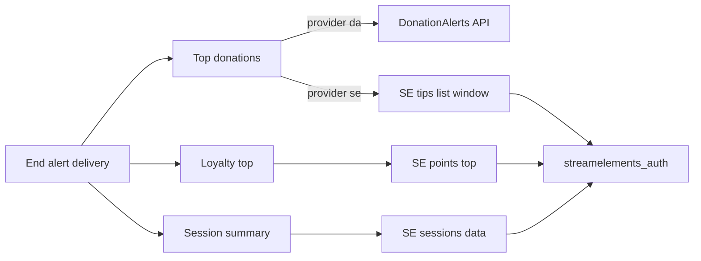

# TODO: StreamElements — топ донатов / loyalty / итоги стрима

Дата: 2026-11-26  
Статус: **на паузе** — заявка на OAuth2 credentials отправлена в StreamElements; код не трогаем, пока не придут `client_id` / `client_secret` (или отказ).  
Связанный код (после снятия паузы): `streamelements.py` (новый), `donationalerts.py` (образец), `health.py`, `handlers/wizard.py`, `handlers/notifications.py`, `handlers/subscriptions.py`, `handlers/settings.py`, `oauth_tokens.py`, `alert_settings.py`, `db/*`, `config.py`, `.env.example`  
Доки SE: [OAuth2 (Stoplight, часто пустой)](https://dev.streamelements.com/docs/api-docs/cd02cda5171ea-o-auth2), [GitHub OAuth2.md](https://github.com/StreamElements/api-docs/blob/main/docs/OAuth2.md), [session data](https://docs.streamelements.com/overlays/session-data)  
Контекст: end-alert extras; Nightbot **не** даёт tips/raid/host — только SE (+ уже есть DA для топа).

Cursor plan (архив): `.cursor/plans/streamelements_end_alerts_ab83d4f6.plan.md` (если есть локально).

---

## Решение (зафиксировано)

| # | Решение |
|---|---|
| 1 | **Топ донаты:** один чекбокс + выбор источника DA / SE (оба auth → спросить; один → взять его; ноль → кнопки link для настроенных провайдеров) |
| 2 | **Rollout:** сразу **GA** (без beta-gate). Loyalty + итоги — free end-alert extras, как top; нужен SE OAuth владельца |
| 3 | По окончании реализации — черновик `bot_update` в стиле admin broadcast id=19; рассылку не слать без явного «шли» |
| 4 | Реализация **на паузе** до ответа SE по OAuth app |

---

## Текущий статус OAuth

- **2026-11-26:** заявка отправлена (support / contact).
- У SE **нет** self-serve «Create OAuth app». Страница docs, на которую ссылался staff («fill out this form»), — сломанный Stoplight без формы.
- Рабочий канал заявки: [Submit a request](https://support.streamelements.com/hc/en-us/requests/new) или [Contact](https://streamelements.com/contact); Account ID: [dashboard/account/channels](https://streamelements.com/dashboard/account/channels).
- Риск: в community (апр. 2026) писали, что OAuth «больше не поддерживают». При отказе — фича остаётся `configured()==False`.

**Когда пришлют credentials**

```
Redirect URI (exact): https://twitchbot.games/oauth/streamelements/callback
Scopes: channel:read tips:read loyalty:read
App name: Twitch Telegram Bot (twitchbot.games)
```

Дальше: `dotenvx set STREAMELEMENTS_CLIENT_ID/SECRET` + VPS plaintext `.env` + recreate bot (`twitch-client-secret.mdc`).

**Черновик заявки (EN), если нужно повторить:**

```
Subject: OAuth2 application credentials request

Hello,

I need OAuth2 client_id and client_secret for a Telegram bot that reads StreamElements data on behalf of streamers who authorize the app (tips top, loyalty leaderboard, session stats for end-of-stream alerts).

Product: Twitch → Telegram alerts bot
Site: https://twitchbot.games
SE Account ID: <PASTE_FROM_dashboard/account/channels>
Contact email: biz@themarfa.name

Please register an OAuth2 application with:
- App name: Twitch Telegram Bot (twitchbot.games)
- Redirect URI (exact): https://twitchbot.games/oauth/streamelements/callback
- Scopes: channel:read tips:read loyalty:read
- Grant type: authorization_code (+ refresh_token)

Docs we follow: https://github.com/StreamElements/api-docs/blob/main/docs/OAuth2.md

Thank you.
```

---

## Продукт (после снятия паузы)

End-alert:

1. **Топ донатов** — DA или SE (провайдер на подписке).
2. **Loyalty top** — топ баллов SE (`{loyalty_user}`, `{loyalty_points}`).
3. **Итоги стрима** — session counters SE (`{session_followers}`, `{session_subs}`, `{session_tips}`, `{session_cheers}`, `{session_top_tipper}`, `{session_top_tip}`).

Порядок блоков в сообщении: топ → loyalty → итоги.



---

## Данные

Таблица `streamelements_auth`: `owner_id`, `se_channel_id`, `se_username`, encrypted refresh/access, `access_expires_at`.

Колонки `subscriptions`:

- `top_donations_provider` — `da` | `se` | `''` (legacy: top on + пусто → DA auth иначе SE auth)
- `loyalty_top` + `loyalty_top_template`
- `session_summary` + `session_summary_template`

---

## Чеклист реализации (не начинать до credentials / явного «снимаем паузу»)

- [ ] `.env.example` + `config.py`: `STREAMELEMENTS_CLIENT_ID` / `STREAMELEMENTS_CLIENT_SECRET`
- [ ] `streamelements.py` — OAuth + tips / points top / sessions
- [ ] DB: `streamelements_auth` + колонки подписки (sqlite + postgres + models + protocol)
- [ ] `health.py` — `/oauth/streamelements/callback`, bridge, health component
- [ ] Revoke SE в настройках токенов (рядом с DA)
- [ ] Wizard/edit: provider picker + toggles loyalty/session + шаблоны
- [ ] Delivery suffixes в `handlers/notifications.py`
- [ ] Locales ru/en (+ uk/it), README, guide, `user-flow-map.ru.md`
- [ ] `self_check` + спросить про flow-nav §2
- [ ] Черновик `bot_update` в стиле broadcast #19

---

## Вне скоупа

- Nightbot (нет tips/raid/host API)
- SE activities → realtime tip/raid alerts
- Overlays / bot commands write
- Admin broadcast без явного «шли»

---

## Снятие паузы

1. Есть `STREAMELEMENTS_CLIENT_ID` + `SECRET` (или явный отказ → закрыть todo / pivot).
2. Пользователь: «снимаем паузу» / «делай SE».
3. Реализовать чеклист выше; не слать `bot_update` без согласования текста.
